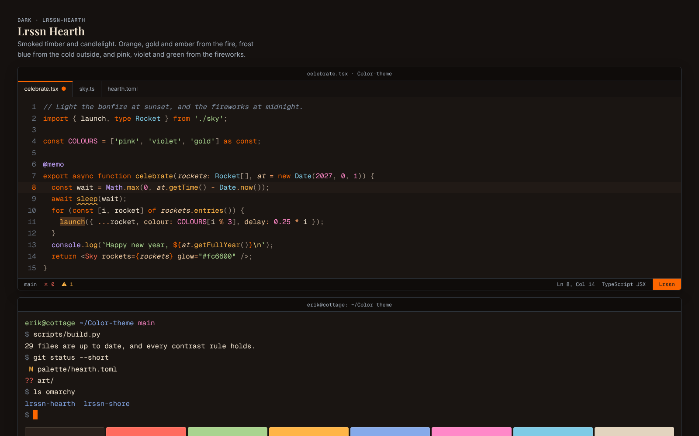
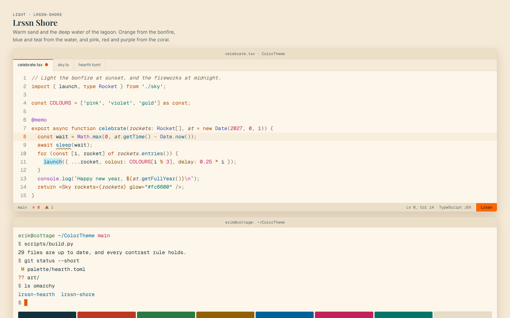

# ColorTheme

This repo holds the Lrssn colour themes: **Lrssn Hearth**, a dark theme, and **Lrssn Shore**, a light theme.
Both are built around the brand orange `#fc6600`.
It is a companion to the [Lrssn style guides](https://github.com/Lrssn-blog/Style-guide) and the [Lrssn brand guide](https://github.com/Lrssn-blog/Brand-guide).

- **Lrssn Hearth** is a cottage on New Year's Eve: warm inside by the log fire, and cold outside, where fireworks go off over the snow.
- **Lrssn Shore** is a warm summer evening on a beach, with a bonfire, clear tropical water and coral.





The [colour guide](./Theme.md) explains the palettes, the roles and the contrast rules.
To see both themes side by side, open [`preview/index.html`](./preview/index.html) in a browser.

## Themes

| Target | Files | Install |
| --- | --- | --- |
| VS Code | [`vscode/`](./vscode) | [VS Code](#vs-code) |
| Neovim | [`colors/`](./colors), [`lua/`](./lua) | [Neovim](#neovim) |
| Alacritty, Ghostty, kitty, Windows Terminal and iTerm2 | [`terminal/`](./terminal) | [Terminals](#terminals) |
| Omarchy | [`omarchy/`](./omarchy) | [Omarchy](#omarchy) |
| The Lrssn website | [`website/_theme.scss`](./website/_theme.scss) | [The website](#the-website) |
| LaTeX | [`latex/lrssntheme.sty`](./latex/lrssntheme.sty) | [LaTeX](#latex) |

Every file in those folders is generated from [`palette/hearth.toml`](./palette/hearth.toml) and [`palette/shore.toml`](./palette/shore.toml), except the VS Code manifest and the Lua modules in `lua/lrssn/`.

## Install

Clone the repository first:

```bash
git clone https://github.com/Lrssn-blog/ColorTheme.git
cd ColorTheme
```

### VS Code

Link the extension into the extensions folder of VS Code, restart VS Code, and choose **Lrssn Hearth** or **Lrssn Shore** with **Preferences: Color Theme**:

```bash
ln -s "$PWD/vscode" ~/.vscode/extensions/lrssn.lrssn-themes-1.0.0
```

The [extension's README](./vscode/README.md) covers Windows, packaging a `.vsix` file, and following the system theme.

### Neovim

The repository is a Neovim plugin.
With [lazy.nvim](https://github.com/folke/lazy.nvim):

```lua
{
  'Lrssn-blog/ColorTheme',
  name = 'lrssn',
  lazy = false,
  priority = 1000,
  config = function()
    vim.cmd.colorscheme('lrssn-hearth')
  end,
},
```

In [LazyVim](https://www.lazyvim.org/), set `colorscheme = 'lrssn-hearth'` in the options of `LazyVim/LazyVim` instead of the `config` function.

`:colorscheme lrssn-shore` loads the light theme.
Setting `background` switches between them, so `:set background=light` turns Hearth into Shore.
The themes include a lualine theme, which lualine picks up by itself.

### Terminals

Each terminal has one file per theme in `terminal/`.

- **Alacritty:** copy the files to `~/.config/alacritty/themes/`, and import one in `alacritty.toml`:

  ```toml
  [general]
  import = ["~/.config/alacritty/themes/lrssn-hearth.toml"]
  ```

- **Ghostty:** copy the files to `~/.config/ghostty/themes/`, and follow the system theme with `theme = light:lrssn-shore,dark:lrssn-hearth` in the config.
- **kitty:** copy a file next to `kitty.conf`, and add `include lrssn-hearth.conf`.
  To follow the system theme, save the files as `dark-theme.auto.conf` and `light-theme.auto.conf` in the config folder instead.
- **Windows Terminal:** add the object in each JSON file to `schemes` in `settings.json`, and set `"colorScheme": { "dark": "Lrssn Hearth", "light": "Lrssn Shore" }` in a profile.
- **iTerm2:** open **Settings > Profiles > Colors > Color Presets > Import**, and choose a file from `terminal/iterm2/`.

### Omarchy

Copy a theme folder into the Omarchy themes folder, and set it:

```bash
cp -r omarchy/lrssn-hearth ~/.config/omarchy/themes/
omarchy-theme-set lrssn-hearth
```

Each folder holds the colours as `colors.toml`, from which Omarchy generates the configs of Hyprland, Waybar, the terminals and the other apps.
It also holds a wallpaper, a preview and a `neovim.lua` that loads this repository's Neovim theme with lazy.nvim.

Copy the folder rather than using `omarchy theme install`.
That command expects the theme at the root of a repository, and it drops the `neovim.lua` of a theme installed from git.

The Omarchy themes do not include a VS Code theme, so install the [VS Code extension](#vs-code) as well.

### The website

[`website/_theme.scss`](./website/_theme.scss) holds the two maps of the Lrssn website's stylesheet: Shore as `$theme-light` and Hearth as `$theme-dark`.
They have the same 51 tokens, in the same order, as `src/styles/_variables.scss` in Lrssn-com.
To use the themes on the website, replace the two maps in that file with these.

The [brand guide](https://github.com/Lrssn-blog/Brand-guide) checks its colour tables against the website's stylesheet, so update its tables in the same change.

### LaTeX

Copy [`latex/lrssntheme.sty`](./latex/lrssntheme.sty) to your local TeX tree, for example `~/texmf/tex/latex/lrssntheme/`, and load it after the other packages and before `hyperref`:

```latex
\usepackage[shore]{lrssntheme}
\usepackage{hyperref}
\hypersetup{
    colorlinks=true,
    linkcolor=LrssnPrimaryText,
    citecolor=LrssnPrimaryText,
    urlcolor=LrssnPrimaryText,
}
```

The options are:

- `shore`, the default, for print: the page stays white, and the colours are Shore's.
- `hearth`, for PDFs read on a screen: a dark page with light text.
- `nolistings`, to leave out the style for `listings`.

The package defines semantic colours such as `LrssnText`, `LrssnPrimary`, `LrssnPrimaryText` and `LrssnKeyword`, so a document looks right with either option.
The [colour guide](./Theme.md#roles) lists what each role is for.

## Layout

- `palette/`: the two palettes, which are the source of every colour.
- `templates/`: one template for each generated file.
- `scripts/build.py`: generates the files, and checks the contrast.
- `scripts/render-art.sh`: renders the wallpapers in `art/` and the previews to PNG.
- `Theme.md`: the colour guide, whose tables are generated.
- `vscode/`, `colors/`, `lua/`, `terminal/`, `omarchy/`, `website/` and `latex/`: the themes.
- `art/`: the wallpapers, drawn on a canvas in the palette's colours.
- `preview/`: a page that shows both themes.

## Checks

Pull requests run these checks via GitHub Actions:

- [markdownlint](https://github.com/DavidAnson/markdownlint-cli2) on the Markdown files.
- [Ruff](https://docs.astral.sh/ruff/) and [mypy](https://mypy-lang.org/) on the scripts.
- `scripts/build.py`, which fails if a generated file is out of date or a colour has too little contrast.
- A link check with [lychee](https://github.com/lycheeverse/lychee).

To run them locally:

```bash
npx markdownlint-cli2
ruff check && ruff format --check
mypy scripts
scripts/build.py
lychee --config .lychee.toml '**/*.md'
```

After changing a palette or a template, run `scripts/build.py --write`, and then `scripts/render-art.sh` to render the wallpapers and the previews again.

## Licence

Copyright (C) 2026 Lrssn-blog.

The themes are free software: you can redistribute them and modify them under the terms of the [GNU Affero General Public License](./LICENSE), either version 3 of the License or (at your option) any later version.
